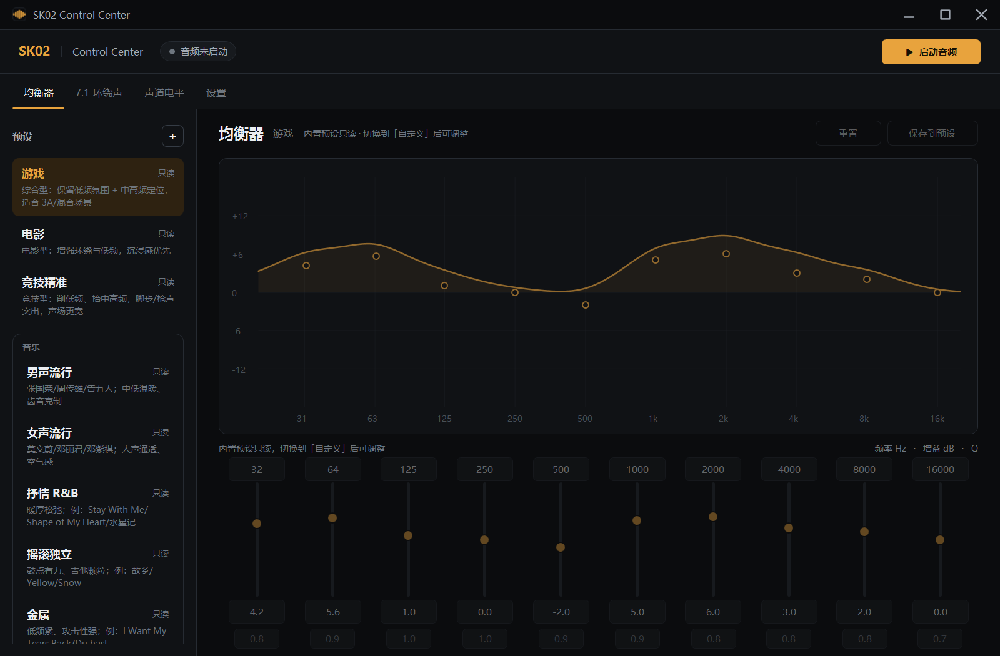
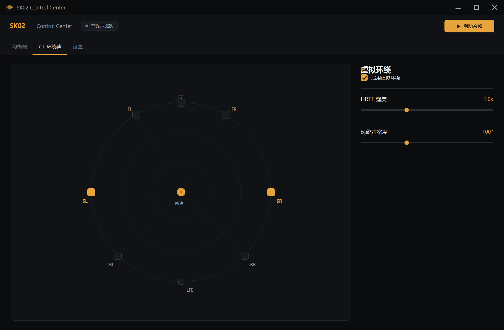
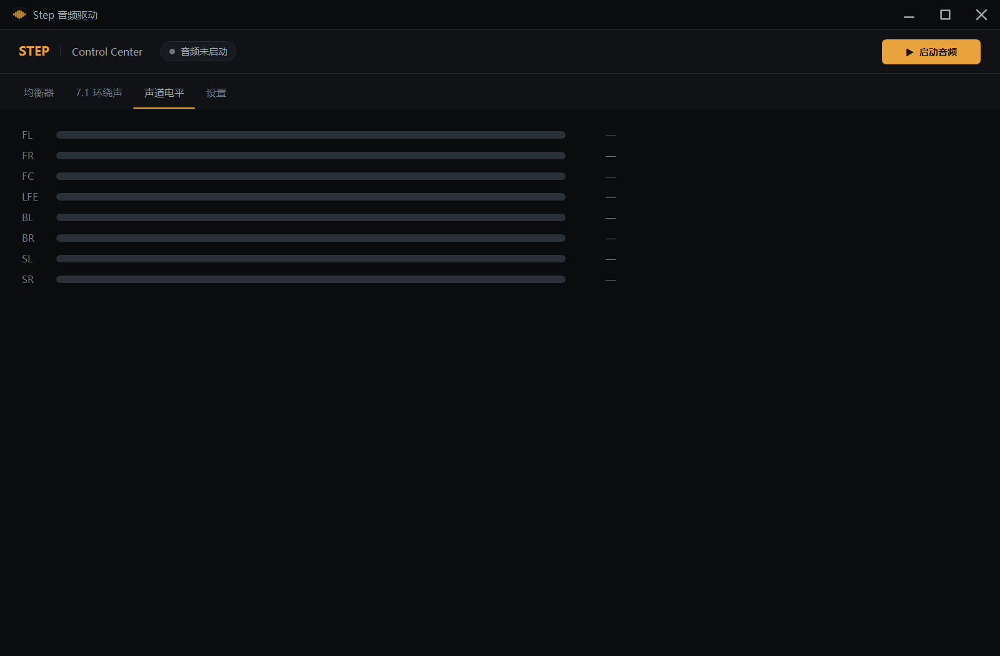
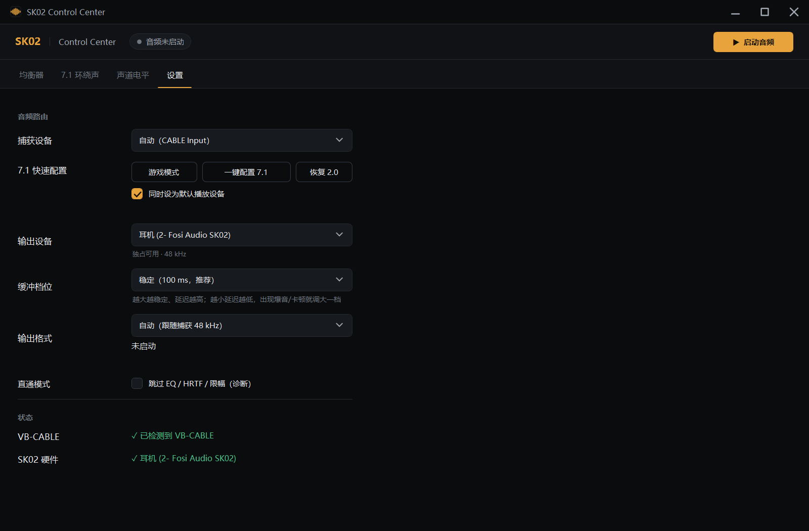
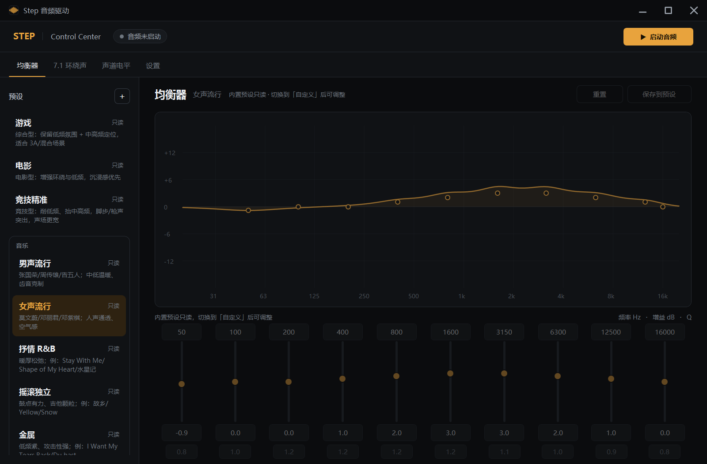
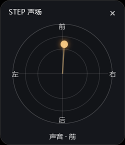

# Step 音频驱动

[](https://github.com/cgxgeyw/StepAudioDriver/releases/latest)
[](LICENSE)
[](https://github.com/cgxgeyw/StepAudioDriver)

面向 FPS 游戏与日常听歌的 Windows 虚拟 7.1 音频控制中心。为 **Fosi Audio SK02** 优化，也支持其它 WASAPI 输出设备。



## 功能

- **虚拟 7.1 环绕**：8 声道捕获 → HRTF → 立体声耳机，支持 FL/FR/FC/LFE/BL/BR/SL/SR
- **Rust DSP 热路径**：256-tap HRIR 卷积、128 帧分块、512 点 FFT、overlap-add；C# 回退可用
- **10 段参数 EQ + 高低搁架**：每段独立增益、中心频率、Q（0.5–10）；低频/高频搁架各有独立频率、增益、Q
- **按风格重做的预设**：游戏 / 电影 / 竞技精准 / 男声 / 女声 / R&B / 摇滚 / 金属 / 舞曲 / 交响 / 原声 / 平坦
- **低频控制**：32/64 Hz 低段 + 低频搁架，旧的 BassBoost 不再额外叠加
- **一键游戏模式**：切换 8 声道端点、默认播放设备、捕获和游戏预设
- **方向悬浮窗**：置顶小雷达，根据 8 声道电平实时显示声音来自前/后/左/右
- **声道电平页**：实时查看 8 个声道的 RMS 电平，判断游戏是否真的输出 7.1
- **缓冲档位**：稳定 / 平衡 / 低延迟，按机器承受能力选择
- **设置记忆**：关闭时保存预设、EQ、设备、格式、缓冲；下次启动恢复
- **开机自启动**：登录后自动启动、开始音频并最小化到托盘；卸载时自动清理启动项
- **启动即开始音频**：正常启动和开机自启动都会自动打开音频链路
- **托盘图标**：最小化到托盘，双击恢复；托盘菜单可启动/停止音频或退出
- **关闭询问**：关闭时选择最小化到托盘或退出，可记住选择；设置里可恢复询问
- **自动 preamp**：按预设最大正增益衰减，避免 EQ 顶爆限幅器
- **安装包**：自包含 .NET 8，按用户安装，无需管理员权限

## 截图

| 7.1 环绕 | 声道电平 |
|---|---|
|  |  |

| 设置 / 缓冲 | 预设 |
|---|---|
|  |  |



## 安装

从 [Releases](https://github.com/cgxgeyw/StepAudioDriver/releases/latest) 下载：

```
StepAudioDriver-1.8.0.msi
```

双击安装即可。安装范围为当前用户，目录：

```
%LOCALAPPDATA%\Programs\Step 音频驱动
```

### 前置条件

1. Windows 10/11 x64
2. 安装 [VB-CABLE](https://vb-audio.com/Cable/)（提供 `CABLE Input` / `CABLE In 16ch`）
3. 输出设备：SK02、N9V2 或其它 WASAPI 播放设备

安装包**不包含** VB-CABLE，需要单独安装。

## 快速开始

1. 把游戏/播放器输出设为 `CABLE Input`
2. 打开 Step 音频驱动，选择捕获设备和输出设备
3. FPS 游戏点「游戏模式」；日常听歌直接选预设
4. 如果使用本软件的虚拟 7.1：
   - 游戏内 HRTF / 7.1 虚拟化关掉
   - Windows Sonic / Dolby Atmos for Headphones 关掉
   - 只保留本软件这一级 HRTF

> 7.1 需要 8 声道捕获端点。游戏模式会尝试把 `CABLE In 16ch` 配成 8 声道；游戏需在切换端点后重启。

## 预设

预设不只是响度不同，而是完整的音色方案：

| 预设 | 32/64 Hz | 中高频 | 宽度 / HRTF | 听感 |
|---|---|---|---|---|
| 游戏 | +4.2 / +5.6 | 2k +6 | 120° / 1.2 | 低频氛围 + 脚步/枪声突出 |
| 竞技精准 | -2.1 / -1.4 | 1k +5、2k +4 | 140° / 1.5 | 低频收紧、声场更宽 |
| 男声流行 | +1 / +3 | 160–630 Hz 抬高 | 60° / 0.45 | 中低温暖、齿音克制 |
| 女声流行 | -0.85 / 0 | 1.6–3.15k 抬高 | 60° / 0.45 | 人声通透、空气感 |
| 金属 | +1.1 / 0 | 125–500 收、2k +4 | 110° / 0.6 | 低频紧、攻击性强 |
| 舞曲拉丁 | +6.4 / +4.8 | 2–4k 抬 | 85° / 0.5 | 下潜深、节奏亮 |

完整参数见 [docs/MUSIC_PRESETS.md](docs/MUSIC_PRESETS.md)。

## 技术栈

- .NET 8 / WPF / C# 12
- NAudio 2.2.1（WASAPI loopback、独占/共享输出）
- Rust `cdylib`（`rust/step-dsp`）+ C ABI / P/Invoke
- WiX 5 MSI 安装包

### 音频链路

```
CABLE 8ch 捕获
  → 下混/声道映射
  → HRTF（Rust / C#）
  → 10 段参数 EQ
  → look-ahead 限幅
  → WASAPI 独占（不支持则共享）→ SK02 / 其它设备
```

## 从源码构建

要求：

- .NET 8 SDK
- Rust（仅重新编译 DSP DLL 时需要）
- Windows 10/11 x64

```powershell
dotnet build StepAudioDriver.sln -c Debug
start.bat
```

发布 / 制作安装包：

```powershell
pwsh installer/build-installer.ps1
```

输出在 `artifacts/installer/`。安装包构建说明见 [BUILD_INSTRUCTIONS.md](BUILD_INSTRUCTIONS.md)。

### 重新编译 Rust DSP

```powershell
cd rust/step-dsp
cargo build --release
copy target\release\step_dsp.dll ..\..\src\Step.UI\native\step_dsp.dll
```

C# 回退：设置环境变量 `STEP_DISABLE_NATIVE_HRTF=1`。

## 目录结构

```
src/
  Step.Core/      音频处理、HRTF、EQ、预设、设备
  Step.UI/        WPF 界面、native/step_dsp.dll
  Step.Service/   后台服务
rust/step-dsp/    Rust HRTF DSP
installer/        WiX MSI 与打包脚本
docs/             技术文档与截图
tests/            xUnit 测试
```

## 已知问题 / 限制

- **N9V2 / ATK 驱动**：`FlowAudioDevice.sys` 版本较老，独占初始化可能触发内核 bugcheck。程序对 N9V2 强制共享模式；请更新 ATK 驱动，驱动未更新前建议使用 SK02 或主板输出。
- **延迟**：低延迟档约 90–100 ms 端到端，稳定档约 200 ms；受 Windows loopback、WASAPI 周期和 USB DAC 缓冲限制，不可能做到个位数。
- **PUBG**：FC/LFE 通常没有内容，属正常混音；定位依赖 FL/FR/SL/SR/BL/BR。
- **独占模式**：会抢占其它播放器；设备不支持独占时自动回退共享，设备被占用时直接报错。
- 安装包未签名，SmartScreen 可能提示。

## 贡献

欢迎 Issue / PR。提交前请至少运行：

```powershell
dotnet build StepAudioDriver.sln -c Debug
```

## License

[MIT](LICENSE)

本项目与 Fosi Audio 无隶属关系；使用虚拟声卡和第三方驱动前请自行评估风险。
