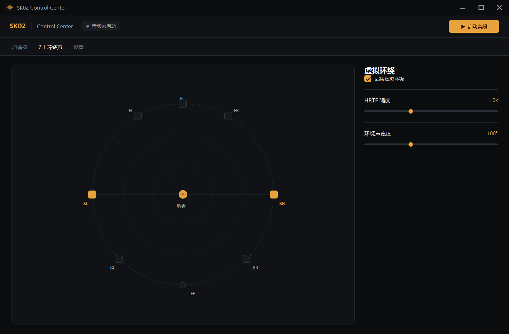

# 步骤 2：HRTF 双耳卷积空间化

**日期**：2025-11（本次改动）
**目标**：把步骤 1 中旁路的“假 7.1”替换成真正的 HRIR 卷积，让虚拟环绕、宽度、强度真正作用于声音。

## 现在做什么



```
多声道输入（1/2/4/6/8ch）
   ↓  按声道映射虚拟扬声器（FL/FR/FC/LFE/BL/BR/SL/SR）
每只扬声器 → 左右耳 HRIR（256 taps）
   ↓  256 帧分块 overlap-add FFT 卷积（512 点 FFT）
双耳累加（等功率混合，LFE 固定增益）
   ↓  干湿混合（HRTF 强度 = 0.5x ~ 2.0x）
立体声 → EQ → 音量 → 输出
```

- **ITD**：Woodworth 球头公式，最大约 0.66 ms（90°）
- **ILD / 头影**：远耳一阶低通（截止 2.5–17.5 kHz）+ 宽频衰减
- **耳廓**：与仰角相关的两个陷波（约 5 kHz / 9.5 kHz）
- **躯干**：约 1.2 ms 的衰减反射（低增益，避免盖过直达声的 ITD）
- **后方音色**：|方位| > 90° 后逐步加入 4.5 kHz 低通、3.2 kHz 陷波和 1.1 kHz 抬升，缓解 0°/180° 前后混淆（实测 0° 与 180° 的高频能量占比约 0.85 : 0.14）
- **前方音色**：|方位| < 90° 时加 3 kHz 耳廓增益（最高 +2.5 dB）和 9 kHz 轻微陷波，让正前方更有存在感，与后方区分更明显
- **宽度**：60° → ±30°；120° → 立体声 ±45°、多声道 ±60°；180° → 立体声 ±60°、多声道 ±72°
  （立体声输入不拉太宽，避免左右声道相关时中间相消；拿到 4 声道以上才用更宽的前方角度）
- **强度**：干湿比（0.5 → 25% 湿声，2.0 → 100% 湿声）

## 方向试听（点击声场任意位置）

`SpeakerDiagramCanvas` 已设为可命中（`Background="Transparent"`），点击**任意位置**都会：

1. 用听者中心到点击点的向量算出方位（0° = 正前，+ = 右，±180° = 后）
2. 生成 4 个短噪声脉冲（2 ms 起振 + 指数衰减，瞬态清晰，ITD 才有意义）
3. 按该方位做 HRIR 卷积，得到双耳立体声
4. 播放：
   - 主链路运行中：混入当前输出（`RealTimeAudioProcessor.PlayTestTone`），不抢设备
   - 未启动：用独立的 `DirectionalTestPlayer` 打开 SK02 播放

标题栏会短暂显示“右前方 45°”这类方位；失败（例如设备被游戏独占）会弹窗提示。

## 本次改动

| 文件 | 内容 |
|---|---|
| `src/SK02.Core/Audio/HRTF/FftN.cs` | 定长 radix-2 FFT（原地、无分配） |
| `src/SK02.Core/Audio/HRTF/ParametricHrir.cs` | 参数化 HRIR 生成（球头 + 耳廓 + 躯干） |
| `src/SK02.Core/Audio/HRTF/SpeakerConvolver.cs` | 单只扬声器的双耳 overlap-add 卷积 |
| `src/SK02.Core/Audio/HRTF/HrtfSpatializer.cs` | 扬声器布局、分块、干湿混合、宽度重建 |
| `src/SK02.Core/Audio/HRTF/DirectionalTestTone.cs` | 方向试听信号生成 + 任意方位双耳卷积 |
| `src/SK02.Core/Audio/DirectionalTestPlayer.cs` | 未启动主链路时的独立试听输出 |
| `src/SK02.Core/Audio/RealTimeAudioProcessor.cs` | 接入空间化器；删除旧固定增益“7.1”；`HrtfEnabled` 默认开启；支持指定捕获设备；测试音混音 |
| `src/SK02.Core/Audio/LoopbackCaptureEngine.cs` | 支持按设备 ID 捕获（7.1 用 `CABLE In 16ch`） |
| `src/SK02.Core/Audio/WaveFormatExtensions.cs` | 32-bit float 的 EXTENSIBLE 判定（上一阶段补充） |
| `src/SK02.UI/MainWindow.xaml(.cs)` | 7.1 页新增“启用虚拟环绕”开关；设置页新增“捕获设备（游戏输出）”下拉；宽度/强度实时生效 |

## 实测（本机 RTX/48kHz）

离线（脚本直接驱动空间化器）：

| 场景 | ITD | ILD |
|---|---|---|
| 宽度 60°（±30°） | 13 samples / 0.27 ms | 5.5 dB |
| 宽度 120°，立体声（±45°） | 18 samples / 0.375 ms | 6.9 dB |
| 宽度 120°，多声道（±60°） | 24 samples / 0.50 ms | 8.4 dB |
| 宽度 180°，立体声（±60°） | 24 samples / 0.50 ms | 8.4 dB |
| 宽度 180°，多声道（±72°） | 27 samples / 0.56 ms | 9.0 dB |
| 单声道（正前） | 0 samples | ≈0 dB |
| 7.1 BL 声道 | 13 samples | 5.7 dB |

- 方向试听音（±90°）：HRIR ITD 32 samples（0.67 ms），左右耳 ILD 8.1 dB，互相关峰值与 HRIR 延迟一致
- 电平：强度 1.2 时，不相关立体声比干声 **-1.8 dB**；完全相关的单声道内容因双耳相消会到 **-5.6 dB**（正常立体声内容接近前者）
- 性能：8 声道 10 秒音频耗时 1.38 s（**7.2x 实时**，单块 6.9 ms）；2 声道约 1/4 开销
- 运行中反复改宽度（60↔180，每 0.5 s 一次）30 秒：无错误、无缓冲丢弃

端到端（真实设备：CABLE Input → SK02，输入 2ch）：

- 有信号、无异常，30 秒 0 次溢出
- 单块处理耗时 2.6–2.8 ms / 50 ms（约 5.5% 单核）
- 缓冲 30–67%，延迟较步骤 1 增加不超过一个卷积块（≤5.3 ms）

## 验证方式

1. 7.1 页勾选“启用虚拟环绕”，播放音乐 → 声场应更“包裹”，左右切换时高频/响度差异明显
2. **在声场图任意位置点击** → 应听到一列短促噪声从该方向传来（侧后方最明显）
3. 拖动“环绕声宽度”：60° 接近普通立体声，180° 声像更外扩
4. 拖动“HRTF 强度”：0.5x 偏干声，2.0x 全卷积
5. 7.1 游戏：把游戏输出设为 `CABLE In 16ch`，设置页“捕获设备”选同一设备，声道数应为 8

## 已知限制

1. **HRIR 是参数化模型，不是实测数据**（KEMAR/CIPIC 数据需要下载和转换，本机网络不可用）。模型接口是 `HrtfSpatializer.GetImpulseResponse()` / `ParametricHrir.Generate()`，替换成实测 HRIR 只需换数据源。
2. **所有虚拟扬声器都在水平面**（elevation = 0），没有高度声道；7.1 的 height 通道暂不特殊处理。
3. **8/16 声道按 WAVE 标准顺序**（FL/FR/FC/LFE/BL/BR/SL/SR）。`CABLE In 16ch` 的后 8 个通道未做映射。
4. **无钟漂补偿**：捕获与输出时钟独立，长时间运行可能出现缓冲溢出（当前 100 ms 缓冲、30 秒测试为 0 丢弃，但不是长期保证）。
5. **改宽度会重建 IR**，极少数情况下可能听到轻微过渡声。
6. 8 声道 CPU 约 14% 单核（未做 SIMD/对称 FFT 优化）。
