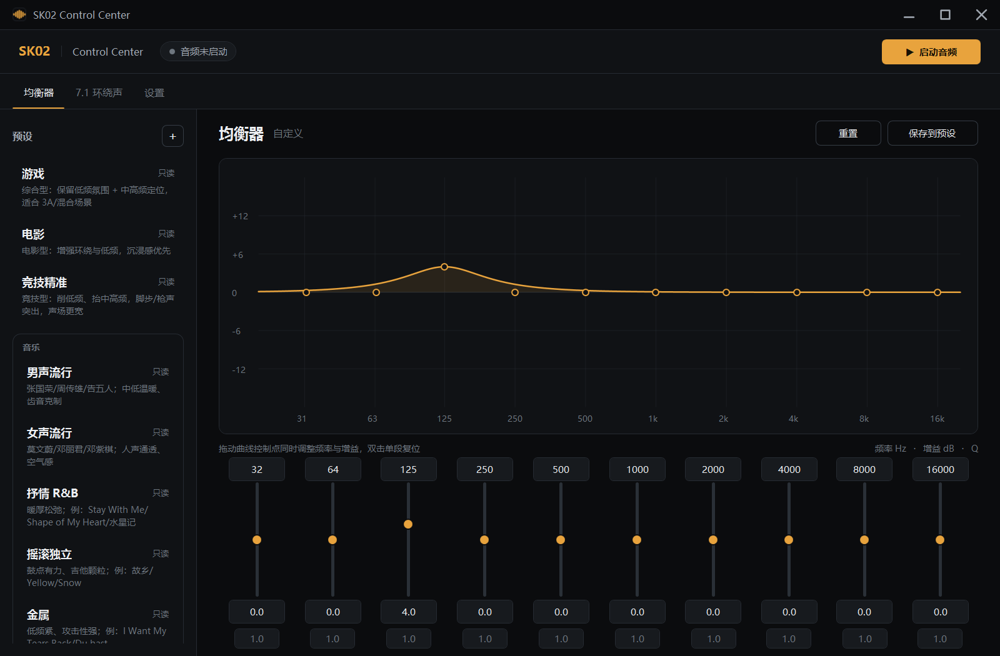
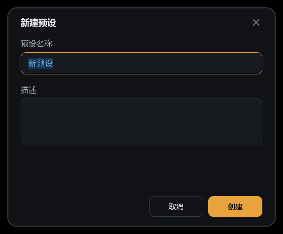
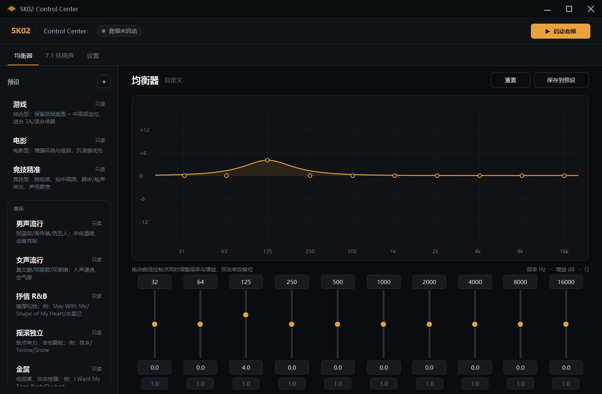
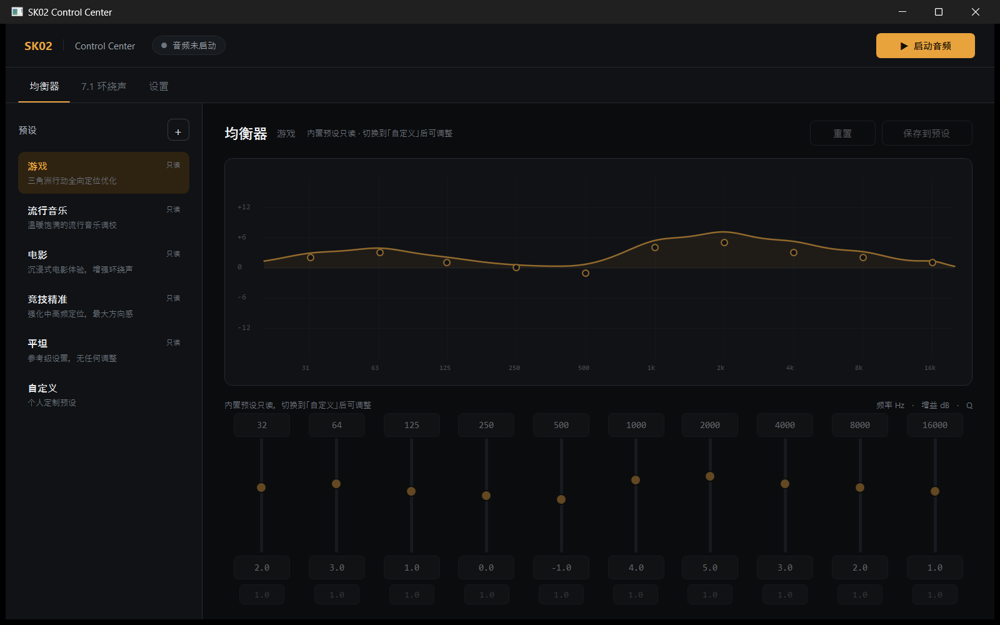
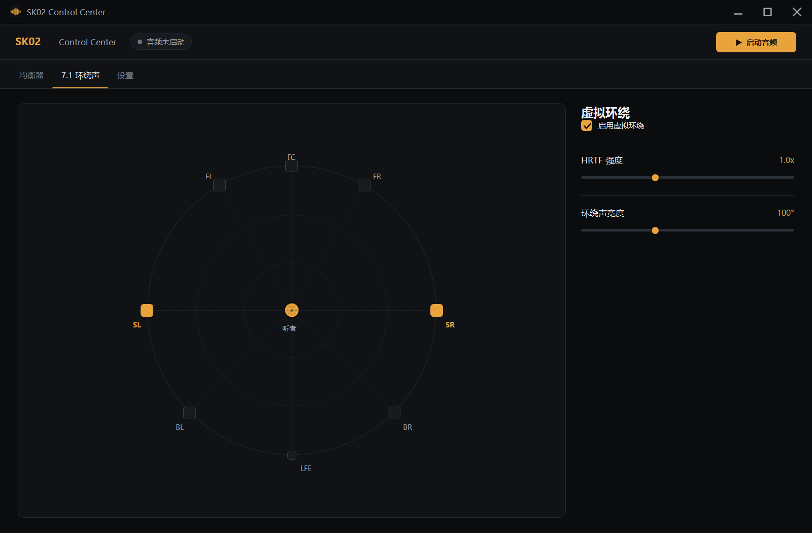
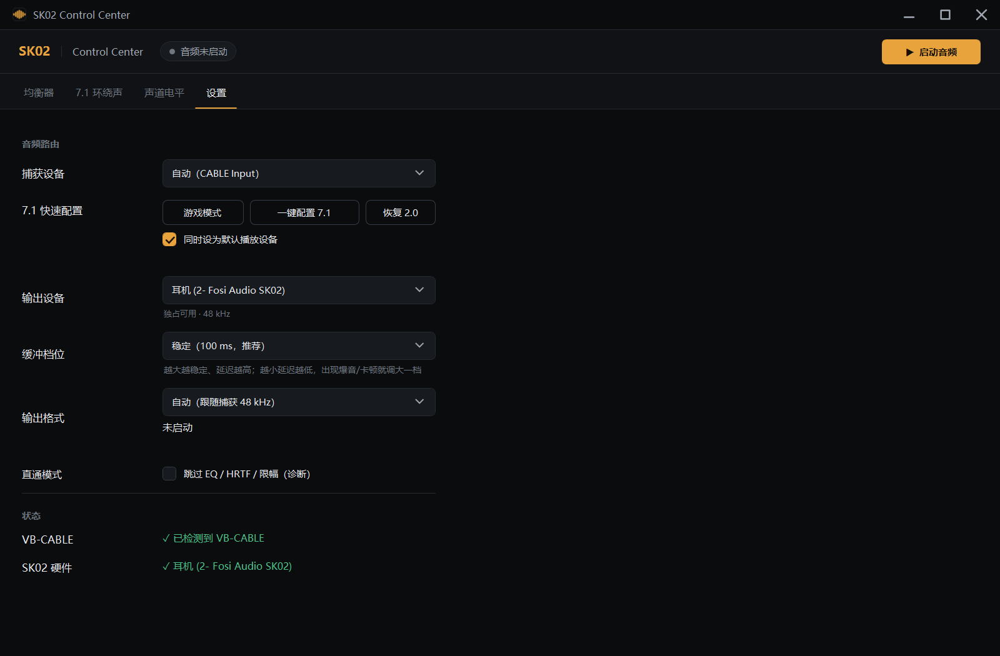
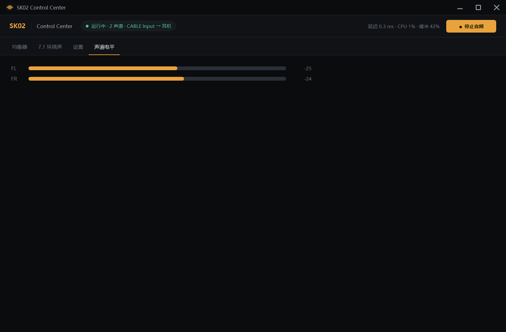
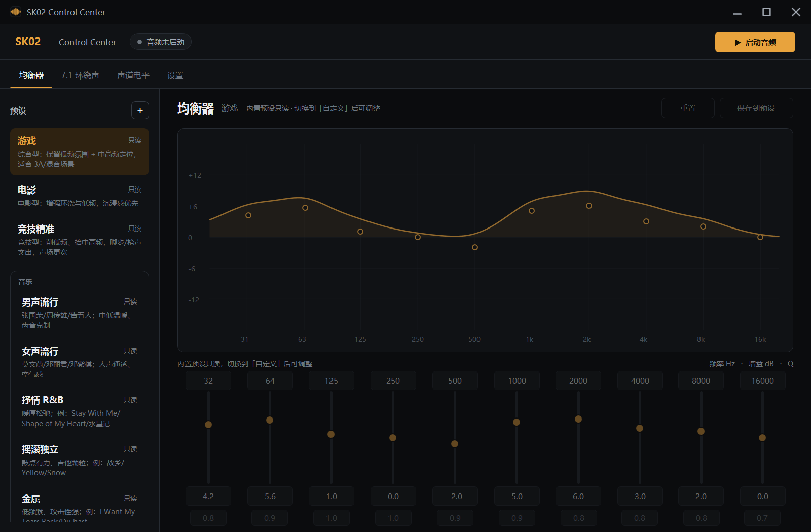
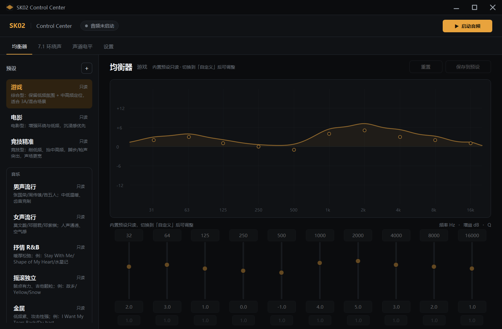

# 界面重做：均衡器交互 + 新视觉风格

**日期**：2025-11
**范围**：重写 `MainWindow.xaml` 与均衡器交互，统一三个页面的视觉语言。

## 方向

使用场景：夜间/暗室，戴着耳机，游戏间隙用第二块屏幕快速调整。要求低眩光、高可读、控件一眼可辨、不抢注意力。

因此选择 **深色暖中性色 + 单一琥珀强调色**（不是常见的冷蓝“游戏风”），强调色只用于主操作、当前选择和数值，其余靠层级和留白。

| Token | 值 | 用途 |
|---|---|---|
| `BrBase` | `#0B0C0E` | 窗口底色 |
| `BrSurface` | `#101215` | 侧栏、标签栏、曲线底 |
| `BrElevated` | `#171A1E` | 输入框、下拉框、浮层 |
| `BrBorder` | `#262B32` | 分隔线、网格 |
| `BrAccent` | `#E8A33D` | 主按钮、滑块、曲线、选中态 |
| `BrAccentDim` | `#2E2211` | 选中的预设行 |
| `BrText1/2/3` | `#ECEEF1` / `#A3AAB4` / `#6E767F` | 主/次/弱文字 |

- 字体：全局 **Microsoft YaHei UI（微软雅黑）**，字号整体比上一版大 1 级；数字也用雅黑
- 标题栏最小化/最大化/关闭改为 2px 圆头线条，比之前的字体图标更粗
- 圆角：卡片/曲线 10，控件 5–8；边框统一 1–2px
- 窗口：1280 × 840（125% 缩放下约 1600 × 1050），自绘标题栏 + Windows 11 圆角

## 窗口与标题栏

- `WindowStyle=None` + `WindowChrome`：保留缩放/贴靠，标题栏完全自绘
- 左上角应用图标（琥珀波形、圆角粗线条），标题栏可拖动、双击最大化
- 右上角最小化 / 最大化 / 关闭；关闭按钮悬停变红
- 图标同时作为 exe 图标和任务栏图标

## 新建预设弹框

- 自绘 `Window`：圆角 14、2px 边框、自绘标题栏，不再使用系统默认窗口
- 名称默认「新预设」并全选；创建按钮随名称是否为空启用
- 创建成功后直接选中新预设，不再弹系统“成功”提示

## 文案精简

- 设置页、7.1 页移除灰色解释性小字（“游戏/播放器输出到哪”“处理后送到哪里”“0.5 偏干声”等），只保留控件和状态值

## 均衡器页

- **曲线可拖动**：10 个控制点支持上下调增益（±12 dB）、左右调频率（20 Hz–20 kHz，自动限制在相邻频段之间），双击单段归零
- **拖动时曲线跟着走**：曲线不再是高斯拟合，而是直接计算 10 段 biquad 的真实幅频响应（和音频线程同一套系数）
- **曲线/控制点/滑块/输入框四向同步**：拖动控制点会更新滑块与数值框；输入数值或拖滑块也会重画曲线
- **列对齐**：10 列由代码生成同一个 Grid（4 行：频率 / 滑块 / 增益 / Q），所有控件严格同列居中
- **输入框加宽**：频率与增益 72px、Q 58px，`16000` 完整显示；Q 与增益之间留 4px 间距
- 选中频段时右上角显示读数（频率 / dB / Q），并在试听时保持高亮
- 预设列表改为“名称 + 描述”的行式列表，选中用底色 + 琥珀文字，不用侧边色条
- 音乐类拆成 8 个内置预设：男声流行 / 女声流行 / 抒情 R&B / 摇滚独立 / 金属 / 舞曲拉丁 / 交响史诗 / 原声 ACG；用一条线框框在一起（不折叠，全部可见）；卡片描述里带示例歌曲，完整对照见 [MUSIC_PRESETS.md](MUSIC_PRESETS.md)
- 预设变多后左侧列表可用滚轮上下滚动；均衡器页任意位置滚轮都会滚动预设列表（不必把指针停在左侧）

### 预设只读

- `gaming` / `movie` / `competitive` / `vocal_male` / `vocal_female` / `ballad_rnb` / `rock_indie` / `metal` / `dance_latin` / `symphonic` / `acoustic_acg` / `flat` 标记为 `isBuiltIn`，选中后：滑块、输入框、曲线拖动全部禁用，保存/重置禁用，显示“只读”
- 只有「自定义」和用户新建的预设可编辑；新建预设会立即选中，便于继续调
- 旧版预设文件没有 `isBuiltIn` 字段，加载时按出厂 ID 自动迁移
- 卡片右上角对内置预设显示“只读”小标记

## 7.1 环绕声页

- 左侧声场图：三圈距离环 + 十字轴 + 侧声道琥珀高亮；点击**任意位置**都会按该方位播放一段 HRTF 噪声脉冲（不是系统提示音），主链路运行时混入当前输出
- 右侧参数纵向排列，用 1px 分隔线替代卡片堆叠
- 开关、滑块、说明文字统一到新的控件样式

## 设置页

- 改为标签 + 控件的两列表单，不再一层层套卡片
- 状态区直接显示 VB-CABLE 与 SK02 的检测结果（之前 SK02 一栏是空的）
- **顶栏显示实际声道数**：`运行中 · 8 声道 · CABLE In 16ch → 耳机`，一眼能看出当前是立体声还是 7.1
- **输出格式**：可选 自动 / 48 kHz 32-bit float / 96 / 192 / 384 kHz 24-bit；启动后显示实际协商结果（含独占/共享）
- **7.1 快速配置**：`一键配置 7.1` 直接把 `CABLE In 16ch` 端点切成 8 声道（`IPolicyConfig`，不需要管理员权限），可选同时设为默认播放设备；`恢复 2.0` 会还原声道和之前的默认设备
- **游戏模式**：一键完成 8 声道配置 + 设为默认 + 选中捕获 + 应用「游戏」预设 + 打开虚拟环绕 + 启动音频；PUBG 自己的 HRTF/7.1 选项仍需在游戏内设置一次
- **Rust DSP**：8 声道 HRTF 卷积已换成 Rust 原生核心（`sk02_dsp.dll`），256-tap 音质不变，实测 0.46ms/10ms；DLL 缺失自动回退 C#（见 [RUST_DSP_CORE.md](RUST_DSP_CORE.md)）
- **缓冲档位**：稳定（100 ms）/ 平衡（60 ms）/ 低延迟（40 ms），捕获与输出同时生效，默认稳定；改动后需重新启动音频
- **输出优先独占**：先尝试独占；设备不支持独占（如 N9V2 dongle）自动回退共享；设备被占用则直接报错，不做混音；启动时自动把 Windows 默认播放切到当前捕获的虚拟线，停止/关闭时还原
- 启动时如果检测到某个虚拟线已经是 5.1/7.1，会自动优先选中它（不用每次手动选捕获设备）
- **停止/关闭时自动还原默认播放设备**：避免系统声音继续被送进虚拟线、导致其它设备没声音；如果原默认设备本身也是虚拟线，则还原到本程序的输出设备

### 一键 7.1 实现说明

- 端点格式：16-bit PCM 的 8 声道 WAVEFORMATEXTENSIBLE（channel mask `0x63F`）
- 混音格式：32-bit float 的 8 声道（虚拟声卡对这组组合接受度最高）
- 设置后立即重新读取 `MixFormat` 验证，失败会显示 HRESULT（如 `0x8889000A` 表示设备被游戏独占）
- 注意：停止/关闭程序会自动还原默认播放设备；如果程序被强制结束，声音可能仍留在虚拟线，用 `恢复 2.0` 或 Windows 声音设置切回

### 输出采样率说明

- CABLE 捕获固定 48 kHz / 32-bit float，这是 DSP 的工作采样率（HRTF 也在这里算）
- 选择更高采样率时，DSP 结果会在输出前用多相 windowed-sinc 升采样（48→96/192/384 为整数倍）
- 384 kHz 下实测：输出「384 kHz · 24-bit PCM · 独占」，缓冲稳定、无丢弃，单块处理约 4.8 ms
- 升采样不会增加源里没有的信息；它只是让 DAC 工作在所选模式。32-bit float 只在 48 kHz 下由设备暴露，384 kHz 时设备给的是 24-bit

## 声道电平页

- 新增独立标签页，实时显示 1–8 个声道的平滑 RMS 电平（dBFS）
- 标签按 WAVE 顺序：`FL FR FC LFE BL BR SL SR`
- 用来判断游戏到底给了几个声道：只有 FL/FR 在动 = 立体声；8 个都在动且内容不同 = 真 7.1；8 个一起动且电平接近 = Windows 上混的假 7.1
- 电平在 DSP 之前读取，不包含 EQ/HRTF 的增益

## 预设重做

- 每个预设保存自己的 10 段中心频率与 Q，切换预设会同步更新频率/Q 输入框和曲线
- `BassBoost` 不再被忽略：按倍率折进 32/64 Hz 两个低架，实时链路真实生效
- 内置预设重新拉开增益：游戏/电影/竞技精准在低频和中高频的差值扩大到 5–7 dB；音乐类通过不同频率/Q 形成音色差异
- 自动 preamp 仍按最大正增益衰减，避免 EQ 后过载

## 启动与记忆

- 预设改为在窗口显示前同步加载，启动瞬间就能看到预设列表，不再空白
- 关闭时写入 `%APPDATA%\SK02AudioDriver\ui-settings.json`：上次预设、10 段 EQ/频率/Q、HRTF 开关与强度、环绕宽度、直通、捕获/输出设备、输出格式、缓冲档位、默认设备勾选
- 下次启动在设备枚举完成后恢复；设备 ID 不存在时回退默认选项
- 强制结束进程不会触发保存

## 验证

- `dotnet build`：0 错误
- 截图：三个页面见上（1600 × 1000，125% 缩放）
- 交互自测：Debug 构建带 `--ui-selftest` 启动时，会选中「自定义」并把 500 Hz 段拖到 700 Hz / +6 dB，结果写入 `%TEMP%\sk02-ui-selftest.txt`：
  `preset=custom freq=700 gain=6.0 box='6.0' freqBox='700' response700=6.14dB selected=4`
- 只读自测：`--ui-locktest` 选中「游戏」，控件禁用并显示“只读”（见上方截图）
- 音频链路回归：UI 自动化点击启动 → `运行中 · CABLE Input → 耳机`，延迟 2.7 ms、缓冲 55%，停止/再次启动正常

## 已知限制

1. 自定义 `TabControl` 模板下，WPF 的 UI Automation 树不暴露标签页内容（只暴露标题栏和标签），屏幕阅读器访问受限；鼠标操作不受影响。
2. 自定义 ComboBox 的下拉浮层无法在无前台窗口的自动化环境里截图验证，逻辑与样式已按标准模板实现。
3. 只有深色主题；没有做主题切换。
4. 曲线拖动时每次鼠标移动都会重建 10 段系数并重绘，当前机器上无卡顿；如果以后加到 31 段，需要做节流。
5. 方向试听在“未启动主链路”时使用独立的共享模式输出；如果游戏正以独占模式占用 SK02，会提示试听失败，启动主链路后再点即可。
